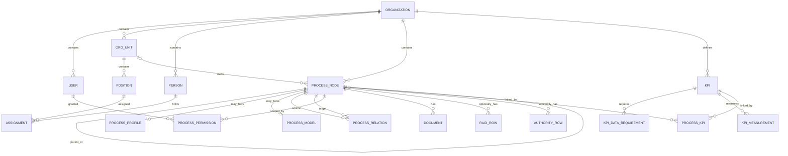

# مدل داده مفهومی و قراردادهای API — نسخه ساده قابل توسعه

## اصول

- هر جدول سازمانی `organization_id` دارد؛ در MVP یک سازمان در هر استقرار.
- شناسه‌ها UUID؛ کد انسانی فرآیند و KPI در محدوده سازمان unique است.
- متن فارسی UTF-8. پاک‌کردن داده دارای وابستگی به صورت محافظت‌شده انجام شود.
- Nodeهای معماری مستقل از گره‌های بصری React Flow هستند: `parent_id` و روابط را منبع حقیقت قرار دهید؛ positions فقط تنظیمات View است.
- شناسنامه/مدل/جداول اختیاری هستند. نبود آنها نباید مانع ایجاد `ProcessNode` شود.

## ERD سطح محصول



## جدول‌های ضروری و حداقل ستون‌ها

| جدول | ستون‌های کلیدی |
| --- | --- |
| organizations | id, name, logo_path, primary_color, created_at |
| users | id, organization_id, username/email, password_hash, role(`ADMIN/EDITOR/VIEWER`), is_active |
| org_units | id, organization_id, parent_id(nullable), name, code(nullable), sort_order |
| positions | id, organization_id, org_unit_id, reports_to_position_id(nullable), title |
| persons | id, organization_id, display_name, email(nullable), phone(nullable) |
| assignments | id, organization_id, person_id, position_id |
| process_nodes | id, organization_id, parent_id, kind(`GROUP/PROCESS`), classification(nullable), code(nullable), name, summary(nullable), owner_org_unit_id(nullable), visibility(`ORGANIZATION/RESTRICTED`), view_x, view_y, created_at, updated_at |
| process_relations | id, organization_id, source_process_id, target_process_id, relation_type(`RELATED/PREREQUISITE/INPUT_FROM/OUTPUT_TO`), note(nullable) |
| process_profiles | id, organization_id, process_id(unique), objective, start_event, end_event, inputs, outputs, roles, expected_outcome, notes |
| process_models | id, organization_id, process_id(unique), bpmn_xml, updated_at, updated_by |
| bpms_references | id, organization_id, process_id, system_name, workflow_code, workflow_name, url, main_steps, decision_rules, kpi_events, notes |
| documents | id, organization_id, process_id, title, doc_type, file_path(nullable), external_url(nullable), mime_type, uploaded_by, created_at |
| raci_rows | id, organization_id, process_id, activity_label, role_label_or_position_id, raci_type(`R/A/C/I`), note(nullable) |
| authority_rows | id, organization_id, process_id, decision_subject, role_label_or_position_id, authority_type, limit_or_condition, notes |
| process_permissions | id, organization_id, process_id, user_id, can_view, can_edit, UNIQUE(process_id,user_id) |
| kpis | id, organization_id, code, name, description, purpose, formula_text, numerator_text, denominator_text, unit, preferred_direction(`HIGHER/LOWER/TARGET_RANGE`), frequency, owner_person_id(nullable), data_source, breakdown_level, target_value(nullable), readiness_status(`UNASSESSED/DEFINED/GAP/READY`), created_at, updated_at |
| process_kpis | id, organization_id, process_id, kpi_id, UNIQUE(process_id,kpi_id) |
| kpi_data_requirements | id, organization_id, kpi_id, system_name, entity_name, field_or_event_name, required_for, availability_note, is_available(nullable) |
| kpi_measurements | id, organization_id, kpi_id, period_start, period_end, actual_value(decimal), note, recorded_by, created_at, UNIQUE(kpi_id, period_start, period_end) |

متن چندمقداری در شناسنامه (ورودی‌ها و خروجی‌ها) می‌تواند برای MVP به شکل JSON string[] یا متن چندخطی ثبت شود؛ در صورت نیاز بعداً نرمال‌سازی می‌شود. برای KPI تاریخ دوره و مقدار عددی مستقل ذخیره شود؛ در `kpis` فرمول **متنی** است و موتور ارزیابی فرمول وجود ندارد.

## قواعد رابطه و سازگاری

1. `kind=PROCESS` می‌تواند فرزند گروه یا فرآیند باشد، اما تنها `PROCESS` شناسنامه، BPMN، KPI و جدول اختیاری دارد.
2. تغییر والد در معماری نباید چرخه ایجاد کند؛ خود والد یا یکی از فرزندان نمی‌تواند والد جدید باشد.
3. هر رکورد روابط و API متعلق به همان سازمان باشد؛ `organization_id` تمام سمت‌ها و کلیدهای خارجی validate شوند.
4. `ProcessRelation` مستقل از hierarchy و صرفاً برای ارتباطات افقی است.
5. حذف گروه با فرزند ممنوع، مگر جابه‌جایی عمدی قبلی؛ حذف فرآیند ارجاع‌داده‌شده ممنوع تا روابط اصلاح شوند.
6. `process_kpis` تنها در صورت `kind=PROCESS` معتبر باشد.
7. KPI بدون process link مجاز است تا برای شاخص سازمانی یا نسخه بعد کاربرد داشته باشد.
8. بخش OKR در آینده `objectives`, `key_results`, `key_result_kpis` خواهد بود؛ **در MVP جدول خالی غیرضروری نسازید.**

## مدل احراز هویت و دسترسی

| اقدام | ADMIN | EDITOR | VIEWER |
| --- | --- | --- | --- |
| مدیریت سازمان/کاربر | بله | خیر | خیر |
| مدیریت چارت | بله | خیر در MVP | خیر |
| ایجاد فرآیند/گروه | بله | بله برای گروه‌های قابل ویرایش (یا توسط مدیر) | خیر |
| مشاهده فرآیند سازمانی | بله | بله | بله |
| مشاهده فرآیند محدود | بله | فقط grant | فقط grant |
| ویرایش فرآیند | بله | فقط grant explicit | خیر |
| مدیریت KPI | بله | بله (با کنترل لینک به فرآیند مجاز) | خیر |
| مشاهده KPI | بله | بله در محدوده فرآیندهای قابل مشاهده | بله در محدوده فرآیندهای قابل مشاهده |

برای جلوگیری از پیچیدگی: در MVP مجوزدهی فرآیند **به‌صورت مستقیم** است؛ inheritance پیچیده مجوزها لازم نیست. ایجاد child زیر process/group محدود فقط با مجوز ویرایش parent انجام شود. KPI متصل به فرآیند محدود نباید نام فرآیند محرمانه را برای کاربر فاقد مجوز افشا کند.

## API سطح بالا (نمونه مسیرهای پیشنهادی)

```text
POST   /api/auth/login
POST   /api/auth/logout
GET    /api/auth/me
GET    /api/org
PATCH  /api/org
GET/POST  /api/org-units
GET/POST  /api/positions
GET/POST  /api/persons
GET/POST  /api/process-nodes
GET/PATCH/DELETE /api/process-nodes/:id
GET/PUT   /api/processes/:id/profile
GET/PUT   /api/processes/:id/model
GET/POST/DELETE /api/processes/:id/relations
GET/POST/DELETE /api/processes/:id/documents
GET/POST/DELETE /api/processes/:id/raci
GET/POST/DELETE /api/processes/:id/authorities
GET/POST  /api/kpis
GET/PATCH /api/kpis/:id
GET/POST/DELETE /api/kpis/:id/requirements
GET/POST/DELETE /api/kpis/:id/measurements

```

این‌ها قرارداد مفهومی هستند؛ اگر Codex از Next.js Server Actions استفاده کرد، معادل امن و مستندشان پذیرفتنی است.

## سیاست ساخت داده در نصب تازه

- Migration فقط جدول، ایندکس، constraint و ساختارها را ایجاد کند. **هیچ رکورد سازمان، شخص، فرآیند یا KPI به‌صورت seed ساخته نشود**.
- نصب تازه با صفر سازمان و صفر کاربر شروع می‌شود. فرآیند راه‌اندازی اولیه، در یک فرم امن و **با اقدام صریح نصب‌کننده** نام سازمان و مشخصات اولین مدیر را دریافت و هر دو رکورد را در یک تراکنش ایجاد می‌کند؛ بنابراین `users.organization_id` هیچ‌گاه بی‌مرجع نیست. لوگو/رنگ در همین فرم یا بعداً توسط مدیر ثبت می‌شود. این عملیات seed نمایشی نیست.
- جداول `process_nodes`, `process_models`, `kpis` و تمام جداول وابسته بعد از نصب تازه باید دارای صفر رکورد باشند.
- فقط مقادیر enum در schema تعریف شوند، نه رکوردهای آزمایشی مرتبط با حوزه کسب‌وکار.
- `roles` فعلاً enum داخلی است و نیازی به جدول seed اولیه نقش ندارد.
- import فایل‌های راسان جزو API نسخه نخست نیست.
